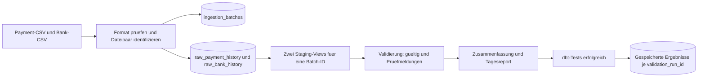

# Transaktionsvalidierung mit Python, PostgreSQL und dbt

[](https://github.com/Titi9625/sql-transaktionsvalidierung/actions/workflows/data-pipeline.yml)

Eine ELT-Pipeline zum Abgleich synthetischer Payment-Provider- und Bankdaten.
Python prüft und lädt CSV-Paare. PostgreSQL und dbt bereiten die Daten auf,
wenden neun fachliche Prüfregeln an und erzeugen gültige Zahlungen,
Prüfmeldungen und tägliche Kennzahlen.

Aus einer Bachelorarbeit an der HTW Berlin weiterentwickelt: Die Portfolio-Version
erkennt bereits geladene Dateipaare, erhält frühere Rohdaten und speichert
erfolgreiche Validierungsergebnisse unter eigenen Lauf-IDs.
Der optionale Stripe-Test-API-Import bleibt ein separater Proof of Concept;
er speist diese CSV-Pipeline nicht.

## Technischer Schwerpunkt

| Bereich | Umsetzung |
|---|---|
| Data Engineering | CSV-Vertrag, SHA-256-Dateipaar-Erkennung, atomare Beladung beider Quellen, Rohdatenhistorie und Pipeline-Runner |
| Analytics Engineering | Sechs dbt-Views, neun Prüfregeln, dokumentierte Modelle und täglicher Reporting-Mart |
| Nachvollziehbarkeit | Batch-ID je Eingabepaar, eigene Validierungslauf-ID, gespeicherte Ergebnisse, Code-Fingerprint und dbt-Laufmetadaten |
| Tests | 68 Python-Tests (davon 7 portable Databricks-Eingabeprüfungen); 28 dbt-Datentests im ursprünglichen Modus, 30 bei benannten Batch-Testfällen |
| CI | GitHub Actions mit PostgreSQL 18, ursprünglicher Pipeline, Batch-Wiederholung, aktualisiertem Snapshot und fehlerhafter Datei |

Das Badge zeigt den Stand von `main`. Den tatsächlichen Status eines Branches
oder Pull Requests zeigt [GitHub Actions](https://github.com/Titi9625/sql-transaktionsvalidierung/actions).

## Databricks-Erweiterung (in Entwicklung)

Eine zweite Umsetzung mit PySpark, SQL und Delta-Tabellen entsteht in
[`databricks/`](databricks/README.md). Die initialen Beispieldaten wurden in
Databricks geladen: 5 Payment- und 3 Bankzeilen. Eine erneute Ausführung fügte
0 weitere Rohzeilen hinzu. Sieben portable Tests prüfen Eingabeformate und
Dateipaar-Identität; sie führen keine Delta-Schreiboperationen aus.
Zwei Silver-Views bereiten geladene Batches für den Vergleich vor: Cent-Beträge
werden in Euro umgerechnet, Datums- und Währungsfelder vereinheitlicht und
Bankreferenz-IDs extrahiert. Im initialen Cloud-Test bleiben 5 Payment- und
3 Bankzeilen einschließlich des doppelten `txn_103` erhalten.
Die neun fachlichen Validierungsregeln, Gold-Reporting und Jobs folgen noch.
Die PostgreSQL/dbt-Pipeline bleibt die vollständige ausführbare Referenz.

## Datenfluss



Ein **Batch** bezeichnet ein vollständiges Eingabepaar. Die Erkennung verwendet
die Bytes beider Dateien, ihre Rollen und die Vertragsversion. Umbenennen
ändert die Identität nicht; veränderte Bytes oder eine andere Partnerdatei schon.
Ein neuer Batch ist ein vollständiger Snapshot, kein zeilenweises Update.

Beide Rohdatenquellen werden gemeinsam committed. Wiederholte Eingaben erzeugen
keine zusätzlichen Rohzeilen. Absichtliche Duplikate innerhalb einer Datei bleiben
erhalten und werden innerhalb des ausgewählten Batches geprüft.

Die sechs dbt-Modelle sind normale Views: Sie speichern Abfragelogik.
`batch_validation` enthält die Views für den zuletzt ausgewählten Batch.
Nach erfolgreichem `dbt build` kopiert Python die Ergebnisse in dauerhafte
`public.validation_*`-Tabellen. Ein neuer Validierungslauf überschreibt frühere
Ergebnisse nicht. Batch-ID und Validierungslauf-ID haben unterschiedliche Aufgaben:
**gleiche Eingabe, mehrere Validierungsläufe** ist ausdrücklich möglich.

## Lokal starten: Windows / PowerShell

Voraussetzungen: Git, Python 3.13 und PostgreSQL 18.
Die Paketversionen stehen in [requirements.txt](requirements.txt).

### 1. Repository und Umgebung

```powershell
git clone https://github.com/Titi9625/sql-transaktionsvalidierung.git
cd sql-transaktionsvalidierung
python -m venv .venv
.\.venv\Scripts\python.exe -m pip install -r requirements.txt
```

Bei vorhandener Arbeitskopie nicht erneut klonen. Bei einem Feature-Branch zuerst
prüfen, ob dessen Änderungen bereits in `main` verfügbar sind.

### 2. Datenbank und Einstellungen

In pgAdmin eine separate Datenbank `portfolio_validation` anlegen.
Nur bei der Ersteinrichtung:

```powershell
Copy-Item .env.example .env
notepad .env
```

Eine vorhandene `.env` nicht überschreiben. Host, Port, Benutzer und Passwort
eintragen; `DB_NAME=portfolio_validation` verwenden. Kein Stripe-Schlüssel nötig.
`.env` und die lokale dbt-`profiles.yml` sind von Git ausgeschlossen.
Die Runner erzeugen temporäre dbt-Profile aus `.env`; keine zusätzliche manuelle
Profilkonfiguration nötig. Die Batch-Pipeline erstellt ihre Tabellen selbst.
Für den lokalen Aufbau einen Benutzer mit Rechten zum Anlegen von Tabellen,
Indizes und Views verwenden; die ursprünglichen SQL-Skripte verwenden `postgres`.

### 3. Initialen Batch laden, prüfen und Ergebnisse speichern

```powershell
.\.venv\Scripts\python.exe .\run_batch_pipeline.py --payment-csv .\testdaten\batch_scenarios\01_initial\payments.csv --bank-csv .\testdaten\batch_scenarios\01_initial\bank.csv --scenario 01_initial
```

Erwartet: 5 Payment-Zeilen, 3 Bankzeilen, 1 gültige Zahlung, 3 markierte
Payment-IDs und 4 Prüfmeldungen. `PASS=36` bedeutet **6 Modelle + 30 Tests**.
Die Ausgabe enthält Batch-ID und gespeicherte Validierungslauf-ID.

Denselben Befehl erneut ausführen: 0 neue Rohzeilen, gleiche Batch-ID,
neuer erfolgreicher Validierungslauf mit eigener ID.

### 4. Aktualisierten Snapshot laden

```powershell
.\.venv\Scripts\python.exe .\run_batch_pipeline.py --payment-csv .\testdaten\batch_scenarios\02_updated\payments.csv --bank-csv .\testdaten\batch_scenarios\02_updated\bank.csv --scenario 02_updated
```

Erwartet: 5/4 Rohzeilen im neuen Batch, 2 gültige Zahlungen, 2 markierte IDs
und 3 Prüfmeldungen. `txn_102` ist jetzt verfügbar und hat eine passende
Bankbuchung. Der frühere Pending-Datensatz und sein Ergebnis bleiben erhalten.
Über beide Batches liegen jetzt 10 Payment- und 7 Bank-Rohzeilen vor.

`--scenario` aktiviert feste Erwartungen für die benannten Testdateien und prüft
deren Fingerprints. Bei eigenen Dateien dieses Argument weglassen. Dann gelten
weiterhin die generischen Tests sowie die Bereitschafts- und Konsistenzprüfungen;
die festen Fixture-Erwartungen werden nicht angewandt.

### 5. Fehlerhafte Datei ablehnen

```powershell
.\.venv\Scripts\python.exe .\run_batch_pipeline.py --payment-csv .\testdaten\batch_scenarios\03_broken_format\payments.csv --bank-csv .\testdaten\batch_scenarios\03_broken_format\bank.csv
```

Erwartet: Rückgabecode 1 und `No database changes.` Der Bankbetrag
`NOT_A_NUMBER` ist ein Formatfehler. Bereits geladene Daten und Ergebnisse
bleiben erhalten. Fehlende Beträge bleiben dagegen `NULL`, damit die fachlichen
Regeln sie prüfen können; ein fehlender Wert wird nicht zu 0.

### 6. Gespeicherte Ergebnisse ansehen

In pgAdmin, verbunden mit `portfolio_validation`:

```sql
SELECT r.validation_run_id, r.batch_id, r.validated_at,
       s.total_payment_records, s.total_bank_records,
       s.valid_records, s.invalid_payment_transactions, s.total_validation_errors
FROM public.validation_runs r
JOIN public.validation_summaries s USING (validation_run_id)
ORDER BY r.validated_at;

SELECT validation_run_id, transaction_id, error_code, error_description
FROM public.validation_findings
ORDER BY validation_run_id, finding_number;
```

| Tabelle | Inhalt |
|---|---|
| `ingestion_batches` | Dateipaar-Fingerprints, Eingabegrößen und Ladestatus |
| `raw_payment_history`, `raw_bank_history` | Quellzeilen mit Batch-ID und Quellzeilennummer |
| `validation_runs` | Lauf-ID, Batch-ID, Code-Fingerprint, Git-Stand falls verfügbar und dbt-Metadaten |
| `validation_summaries` | Zusammenfassung eines erfolgreichen Laufs |
| `validation_valid_payments` | Gültige Zahlungen je Lauf |
| `validation_findings` | Alle Prüfmeldungen je Lauf, einschließlich mehrfacher Meldungen |
| `validation_daily_reports` | Tageskennzahlen je Lauf |

## Neun fachliche Prüfregeln

Implementiert in [dbt_invalid_transactions.sql](dbt_validation_pipeline/models/validation/dbt_invalid_transactions.sql).

| Fehlercode | Auslöser |
|---|---|
| `duplicate_transaction_id` | Mehrere Provider-Zeilen mit derselben nicht-leeren ID |
| `missing_amount` | Provider-Brutto- oder Nettobetrag fehlt |
| `invalid_currency` | Vorhandene Provider-Währung ist nicht EUR |
| `pending_transaction` | Provider-Status ist pending |
| `refund_transaction` | Transaktionstyp ist refund |
| `amount_mismatch` | Passende Provider-/Bankbeträge unterscheiden sich um mehr als 0,01 |
| `missing_bank_match` | Verfügbare Charge ohne passende Bankreferenz |
| `unmatched_bank_transaction` | Extrahierte Bankreferenz-ID hat keinen Provider-Datensatz |
| `bank_reference_id_not_extractable` | Keine unterstützte ID aus Bankreferenz extrahierbar |

Eine Zahlung kann mehrere Meldungen erzeugen. Prüfmeldungen sind nicht die Zahl
unterschiedlicher Zahlungen. Pending und Refund sind Ausnahmen dieses Szenarios,
nicht automatisch wirtschaftlich falsche Zahlungen. `available` bedeutet nicht,
dass Geld bereits auf dem Bankkonto eingegangen ist.

Der [Reporting-Mart](dbt_validation_pipeline/models/reports/mart_daily_reconciliation.sql)
gruppiert unterschiedliche Payment-IDs je Provider-Datum und Quelle. Die
Validierungsquote ist gültige IDs / unterschiedliche IDs; Bank-only-Meldungen
zählen nicht zu diesem Payment-Mart. Gesamtquoten aus summierten Zählern und
Nennern berechnen, Tagesprozente nicht mitteln.

## Ursprüngliche Pipeline und Regressionstests

`run_pipeline.py` bleibt für die ursprünglichen 50 Payment- und 40 Bankzeilen
erhalten. In pgAdmin zuerst `sql_views/00_create_raw_tables.sql` und
`sql_views/04_create_import_runs.sql` in `portfolio_validation` ausführen, dann:

```powershell
.\.venv\Scripts\python.exe .\run_pipeline.py
.\.venv\Scripts\python.exe -m unittest discover -s tests -v
```

Ursprünglicher Modus: Views in `public`, 20 gültige Ergebnisse, 25 markierte
Payment-IDs, 46 Meldungen; `PASS=34` = 6 Modelle + 28 Tests.
Die ursprünglichen Importer ersetzen ihre Rohdatentabellen getrennt mit
`TRUNCATE`/`INSERT` und protokollieren in `import_runs`. Sie verändern die
neuen Batch-Historientabellen nicht.

Die Python-Suite enthält 68 Tests: 61 für den bisherigen Projektstand und sieben portable Prüfungen der Databricks-Eingabelogik. Zwei ursprüngliche Integrationstests prüfen
Rollback und Fehlerprotokollierung in PostgreSQL. Weitere Tests prüfen Parser,
Fingerprints, Batch-Isolation, gespeicherte Ergebnisse und Runner-Verhalten;
ihre Datenbankadapter verwenden SQLite. Sie beweisen keine PostgreSQL-Sperr-
oder Nebenläufigkeitseigenschaften. Die PostgreSQL-Integrationstests erfordern
die ursprünglichen Tabellen und `import_runs` sowie `DB_NAME=portfolio_validation`.
Keine parallelen Importe während dieser Tests starten.

Der [CI-Workflow](.github/workflows/data-pipeline.yml) führt die ursprüngliche
Pipeline zweimal aus und validiert initialen, wiederholten und aktualisierten
Batch. [verify_batch_history.py](tests/verify_batch_history.py) kontrolliert im
frischen PostgreSQL-Testdienst gespeicherte Ergebnisse, Rohdatenmengen und die
Ablehnung fehlerhafter Eingaben ohne Änderungen. Dieser spezielle Prüfer läuft
nur in GitHub Actions, da er einen frischen Datenbestand voraussetzt.
Lokale Zugangsdaten werden nicht für CI verwendet.

## Fehlerverhalten und Grenzen

- Fehler beim Laden rollen beide Quellen dieses Batches zurück. Frühere Batches
  bleiben bestehen. `ready` bedeutet vollständig geladen, nicht fachlich gültig.
- Beladung, dbt-Aufbau und Ergebnisspeicherung sind getrennte Transaktionen.
  Schlägt die Validierung fehl, bleibt der geladene Batch für einen neuen Versuch
  erhalten. Eine erfolgreiche Ergebniskopie wird vollständig committed oder
  zurückgerollt; vorherige Ergebnisläufe werden nicht überschrieben.
- Ein PostgreSQL-Advisory-Lock verhindert gleichzeitige Validierungen über diesen
  Batch-Runner. Direkte dbt-Aufrufe und fremde Schreibzugriffe umgehen diese
  Koordination. Die Pipeline ist kein verteilter Scheduler.
- Der Code-Fingerprint umfasst ausgewählte Validierungsdateien, keine vollständige
  Laufzeitumgebung. Git-Commit und Dirty-Status ergänzen die Herkunft. Historische
  Tabellen sind durch die Anwendung erhalten, nicht gegen Datenbankadministratoren
  manipulationssicher geschützt.
- Kleine synthetische Daten, fester CSV-Vertrag, ein Provider-Quellsystem und
  referenzbasierter Einzelabgleich. Keine realen Sammelauszahlungen, FX-Umrechnung,
  zeilenweisen Upserts oder Lasttests. Die Cloud-Erweiterung ist separat
  in `databricks/` dokumentiert. Weitere NULL-/Statusfälle
  benötigen zusätzliche Regeln. Noch kein Dashboard, Scheduler oder Upload-UI.

## Wichtige Einstiegspunkte

| Datei / Verzeichnis | Aufgabe |
|---|---|
| `run_batch_pipeline.py` | Dateipaar prüfen, Historie laden, dbt ausführen, Ergebnisse speichern |
| `check_input_pair.py`, `register_input_pair.py`, `load_input_pair.py` | Einzelne Vorbereitungsschritte separat ausführen |
| `validate_batch.py` | Ausgewählten Batch validieren und optional Ergebnisse speichern |
| `python_import/csv_contract.py` | Strikter CSV-Vertrag und verlustfreie Betragskonvertierung |
| `python_import/batch_registry.py`, `batch_loader.py` | Identität und atomare Beladung |
| `python_import/result_history.py` | Erfolgreiche Ergebnisse mit Laufmetadaten speichern |
| `sql_views/05_...`, `06_...`, `07_...` | Batch- und Ergebnishistorien anlegen |
| `dbt_validation_pipeline/models/`, `macros/`, `tests/` | Modelle, Batch-Auswahl, Dokumentation und SQL-Tests |
| `testdaten/batch_scenarios/` | Kleine Testszenarien mit exakten Erwartungen |
| `tests/` | Python-Tests und PostgreSQL-CI-Abnahme |

Historische Thesis-Skripte, eigenständige SQL-Views und API-Code sind keine
zusätzlichen Schritte des Batch-Runners. Historische Screenshots in
`ergebnisse/screenshots/` zeigen den ursprünglichen Thesis-Datensatz.

Thesis: *SQL-basierte Validierung von Transaktionsdaten aus Payment-Provider-APIs
und Bankexporten für eine zuverlässige Finanzberichterstattung*, HTW Berlin,
Ingenieurinformatik. Lizenz: [MIT](LICENSE).
